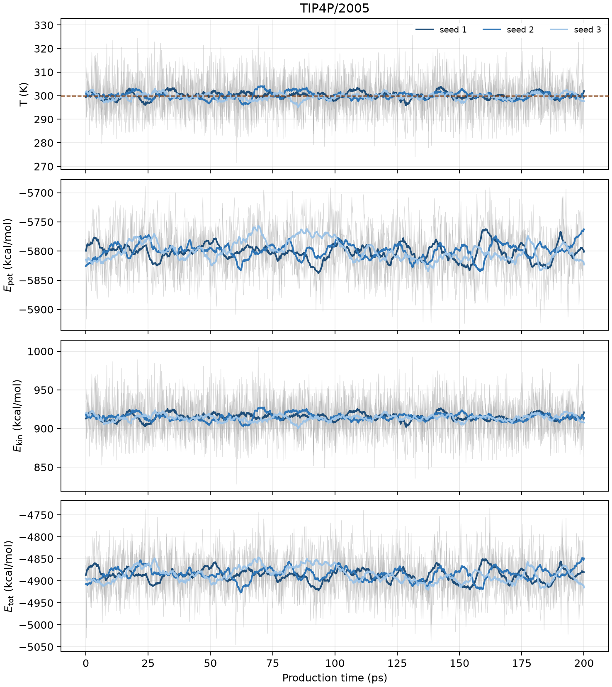
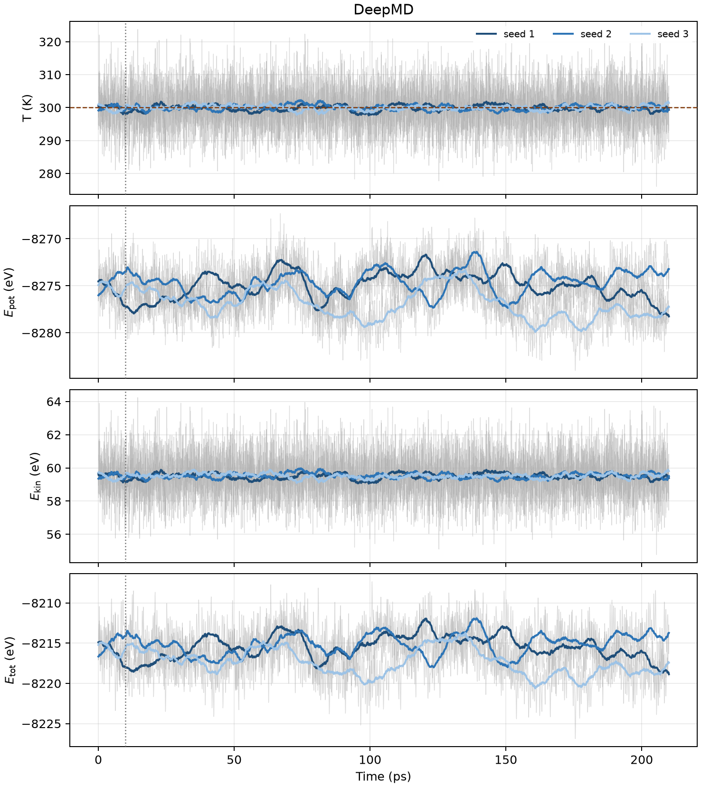
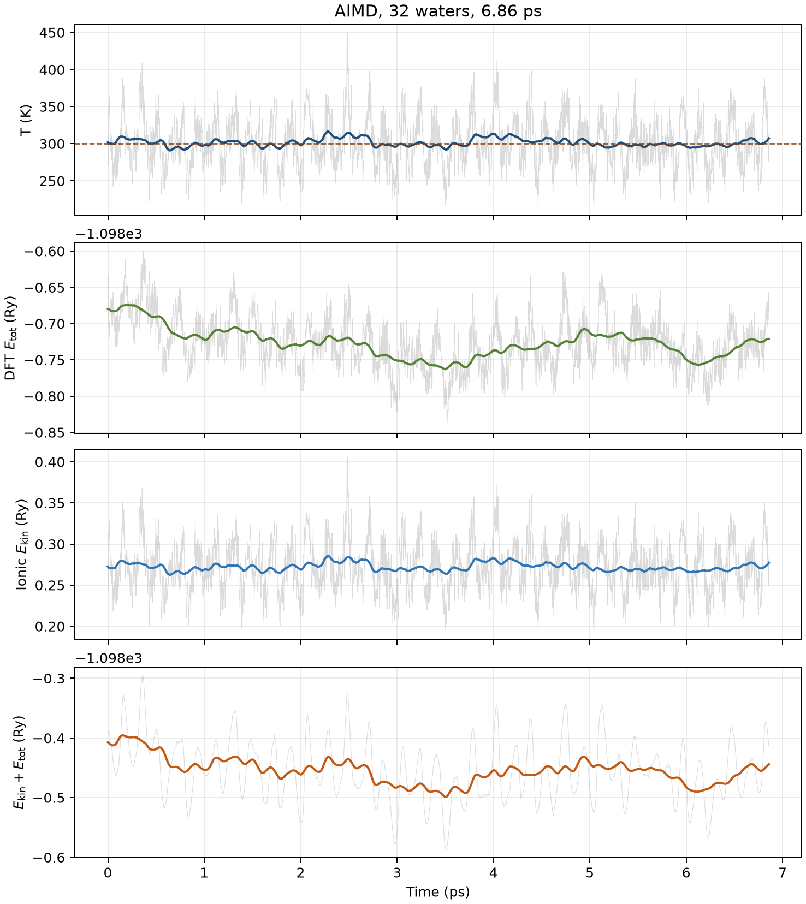
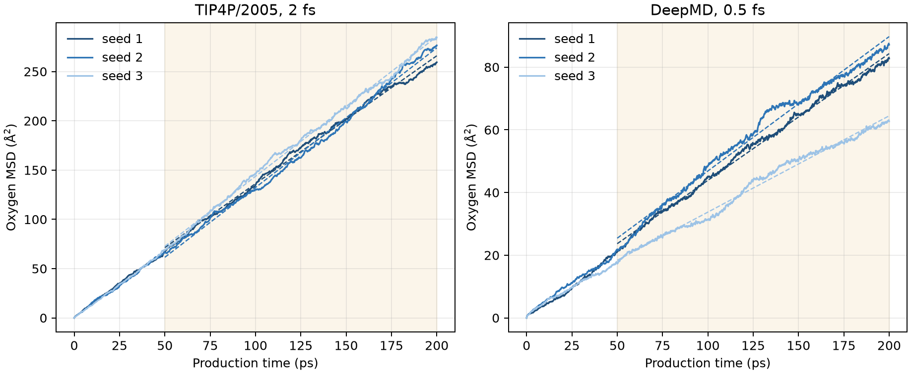
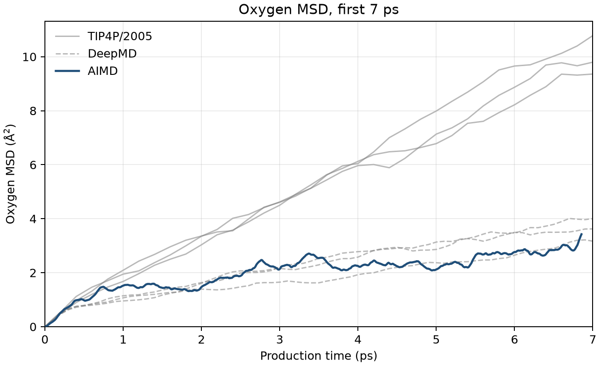
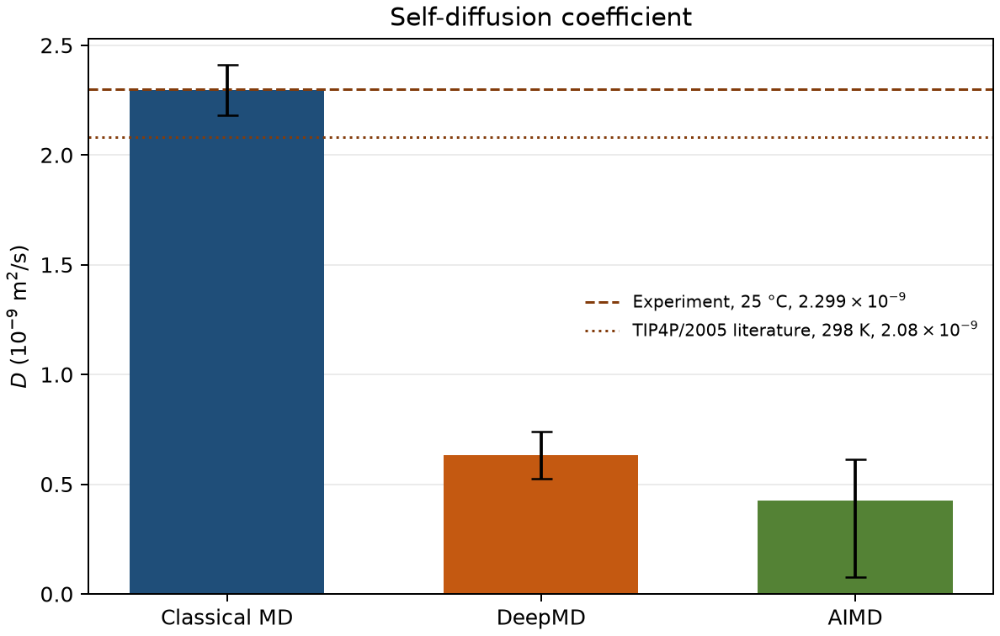
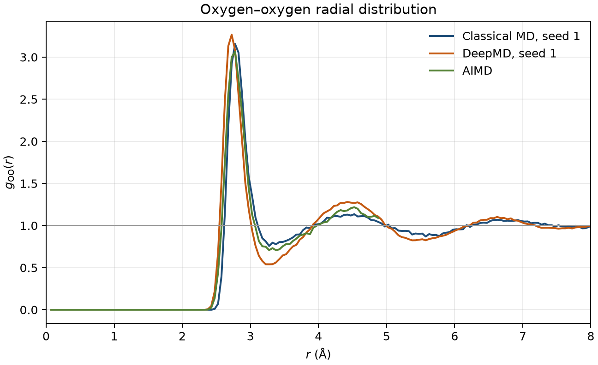
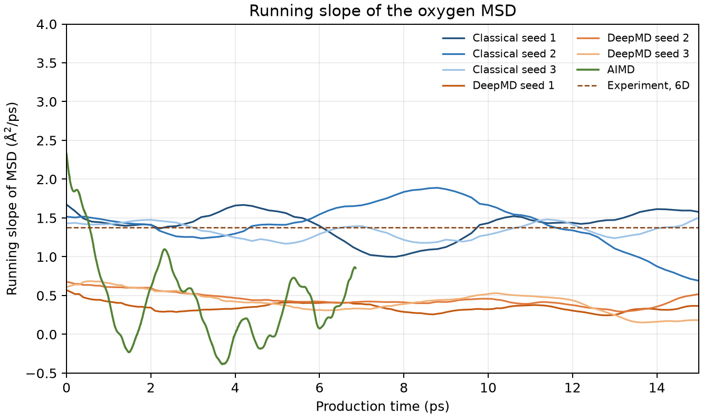
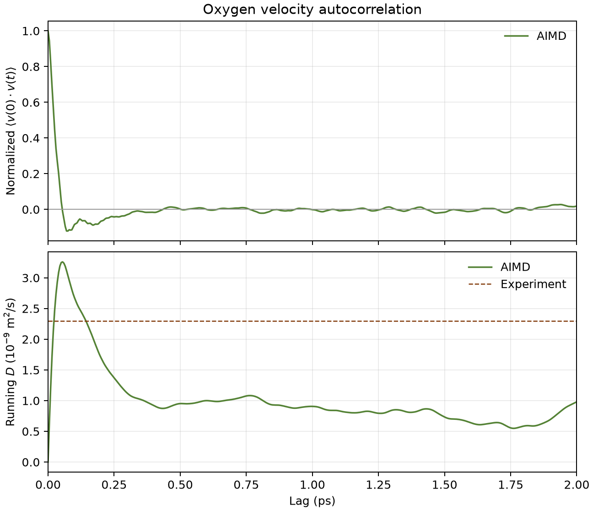
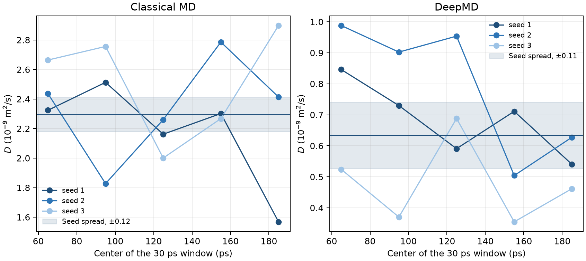

# Project 3: Self-diffusion of water from classical, DeepMD, and AIMD trajectories

MATE 250 · Stephen · 17 November 2026

## Introduction

Molecular dynamics (MD) simulates the motion of a set of atoms by stepping Newton’s second law forward in time. That law says the force on an atom equals its mass times its acceleration, $\(m\, d^2\mathbf{r}/dt^2 = \mathbf{F}\)$. Integrating it means using the forces at the current positions to advance the positions and velocities by a short timestep. The atoms occupy a periodic cell held at chosen thermodynamic conditions. A potential supplies the force on each atom, and the record of positions and velocities is called a trajectory. From that trajectory one reads thermodynamic state variables, such as the temperature and the kinetic and potential energies, and dynamical quantities, such as how far a molecule travels.

This project compares the self-diffusion coefficient of liquid water obtained with three potentials, each following a different set of rules for turning positions into forces. Three trajectories use the TIP4P/2005 classical force field ("classical MD"), three trajectories use a deep neural-network potential (DeepMD) trained on SCAN (strongly constrained and appropriately normed) density-functional data, and one trajectory is ab initio molecular dynamics (AIMD) in which SCAN forces are recomputed at every step. The comparison is whether these three descriptions of the same liquid give the same diffusion coefficient, after the temperature and energy of each run have been checked.

## 1. What is being compared

Self-diffusion is the random walk of a molecule through the liquid. Collisions with neighboring molecules keep changing its direction, so the average displacement stays near zero while the mean-squared displacement grows with time. For a brief interval at the start, before those collisions, the molecule is still coasting at its thermal velocity. The distance traveled is then proportional to time, and the mean-squared displacement rises as $\(t^2\)$. That interval is the *ballistic rise*. In liquid water it lasts a fraction of a picosecond. Once collisions have randomized the direction of motion, the mean-squared displacement (MSD) in three dimensions follows the Einstein relation:

$\[
\mathrm{MSD}(t) = 6Dt,
\]$

where $\(D\)$ in m²/s is $\((\mathrm{slope\ in\ Å^2/ps})/6 \times 10^{-8}\)$. The relation applies only after the ballistic rise, which is why the fits in this report use a later window, 50–200 ps, where the MSD plots are linear. The same slope is calculated for each potential, and those self-diffusion coefficients are then compared with one another and with experiment. The course reference for experiment near room temperature is $\(2.299 \times 10^{-9}\)$ m²/s. 

## 2. Methods

The comparison uses three classical trajectories, three deep-learning trajectories, and one ab initio trajectory. In each case a potential supplies the force, and a Verlet step uses that force to update the positions and velocities. Velocity Verlet is a second-order update: it uses the force at the start of the step and the force at the end of the step. Moving each atom by only its current velocity times the timestep leaves the force out of the position update and is only first-order. The methods differ in where the force comes from: an empirical potential, a neural network trained on density-functional data, or a fresh density-functional calculation.

Every production run is in the NVT ensemble:

- $\(N\)$ is the number of molecules, held fixed. 
- $\(V\)$ is the cell volume, also held fixed, so the density does not change. 
- $\(T\)$ is the temperature, with a target of 300 K.

A Nosé–Hoover thermostat enforces that temperature. It assumes that one extra degree of freedom, evolved with the ions, is enough for the ionic positions and momenta to sample the canonical distribution at 300 K. It violates Newton’s second law for an isolated system: the momentum update includes a friction term that is not a force from the interatomic potential, and the physical energy \(K+U\) is not conserved.

**Table 1.** Production conditions for the three methods.

|            | TIP4P/2005       | DeepMD                       | AIMD                |
| ---------- | ---------------- | ---------------------------- | ------------------- |
| Molecules  | 512              | 512                          | 32                  |
| Cell       | 24.8 Å cube      | 24.8 Å cube                  | 9.8419 Å cube       |
| Density    | 1.004 g/cm³      | 1.004 g/cm³                  | 1.004 g/cm³         |
| Ensemble   | NVT, 300 K       | NVT, 300 K                   | NVT, 300 K          |
| Timestep   | 2.0 fs           | 0.5 fs                       | 0.5 fs              |
| Production | 200 ps × 3 seeds | 200 ps × 3 seeds             | 6.86 ps, one chain  |
| Potential  | rigid TIP4P/2005 | flexible SCAN deep potential | SCAN DFT, each step |

Table 1 shows that the two 512-water models share the box, the density, the thermostat target, and the production length. They do not share a potential or a timestep. Absolute potential energies are not compared: TIP4P energies are in kcal/mol and the DeepMD energies are in eV, and the zeros are unrelated. The Week 10 handout makes the same point [8].

### 2.1 Classical MD

Classical MD takes forces from the TIP4P/2005 potential and integrates them forward in time. The model assumes rigid molecules: SHAKE holds the bond length and angle fixed, the oxygen–oxygen interaction is Lennard-Jones, and the electrostatics are fixed point charges, with no electronic polarization or charge transfer. At each step the analytic force from that potential, together with the Nosé–Hoover friction, updates the velocities and positions. The timestep is 2 fs. Three trajectories use three different initial velocities so the average is not taken from a single path.

Each classical MD trajectory starts from the same restart. That restart was written after a minimization and 10 ps of NVT dynamics on this 512-water cell, 5,000 steps at 2 fs, so production is already at 300 K when the clock is reset to zero. The job then integrates 100,000 steps, which at 2 fs per step is 200 ps. The 2 fs step was chosen from an earlier comparison of 0.5, 1, 2, and 4 fs on this water model. Those runs stayed numerically stable. The 1 fs and 2 fs runs gave nearly the same potential energy, while 4 fs shifted it, and a 2 fs step took about half the computer time of a 1 fs step.

The three trajectories share those positions and that cell. They differ in the velocities. Seed 1 continues the velocities stored in the restart. Seeds 2 and 3 discard them and draw a new set at 300 K, using random seeds 111111 and 234561. Table 2 lists the production settings.

**Table 2.** TIP4P/2005 production settings.

| Setting | Value |
|---|---|
| Units | real (time in fs, energy in kcal/mol) |
| Ensemble | Nosé–Hoover, 300 K, damping 100 fs |
| Timestep | 2.0 fs |
| Constraints | SHAKE on bonds and angles, tolerance $\(10^{-5}\)$ |
| Electrostatics | TIP4P long-range solver, M-site offset 0.1546 Å, LJ cutoff 10 Å, PPPM accuracy $\(10^{-5}\)$ |
| LJ (O–O) | $\(\varepsilon = 0.1852\)$ kcal/mol, $\(\sigma = 3.1589\)$ Å |
| Geometry | $\(r_{\mathrm{OH}} = 0.9572\)$ Å, angle 104.52°, rigid |
| Production | 100,000 steps = 200 ps |
| MSD | oxygen, center-of-mass removed, recorded every 100 steps (0.2 ps) |

The slope is fit from 50 to 200 ps (751 points). The error bar is the sample standard deviation of the three seed values,

$\[
s = \sqrt{\frac{1}{2}\sum_{i=1}^{3}(D_i - \bar D)^2}.
\]$

A separate check splits 50–200 ps into five 30 ps windows. That window-to-window spread is about $\(0.36 \times 10^{-9}\)$ m²/s. It measures how much one trajectory’s slope moves when the fit interval moves. It is not the error bar reported below. Successive MSD points are correlated, so the error bar is the spread of the three seeds.

### 2.2 DeepMD

DeepMD uses the same NVT integration with a neural-network potential in place of a fixed formula. The assumptions are that the energy is a sum of atomic contributions, that each contribution depends only on the neighbors inside a cutoff, and that a network trained on SCAN energies and forces remains accurate for these liquid-water configurations. SCAN is the strongly constrained and appropriately normed density functional named in the introduction. The molecules are flexible: the O–H bond lengths and the H–O–H angle are free to vibrate, whereas classical MD holds them fixed. At each step the network returns the energy and the force is its gradient. The velocity Verlet step from the start of this section then advances the atoms by 0.5 fs. The Nosé–Hoover friction is applied inside that velocity update. It is a drag on each atom’s momentum: above 300 K the drag slows the atoms, and below 300 K the drag changes sign and speeds them up. That drag is not a force from the water potential. No electronic-structure calculation is performed during the trajectory. Three trajectories use three velocity seeds.

Each DeepMD trajectory reads the same equilibrated 512-water structure and the same neural-network potential, the model trained to match SCAN energies and forces. It then draws a fresh set of velocities at 300 K. The three velocity seeds are 23456789, 12345678, and 11111111. The job first integrates 20,000 steps, 10 ps, of NVT equilibration without recording the mean-squared displacement. It then integrates 400,000 steps, 200 ps, of production and records the oxygen MSD from the start of that second stage. The 10 ps equilibration is already near 300 K, so production does not begin from a cold or freshly minimized cell. Table 3 lists the production settings.

**Table 3.** DeepMD production settings.

| Setting | Value |
|---|---|
| Units | metal (time in ps, energy in eV) |
| Model | flexible SCAN deep potential, species ordered O then H |
| Ensemble | Nosé–Hoover, 300 K, damping 0.10 ps |
| Timestep | 0.0005 ps = 0.5 fs |
| Constraints | none; the molecules are flexible |
| Equilibration | 20,000 steps = 10 ps, before the MSD is accumulated |
| Production | 400,000 steps = 200 ps |
| MSD | oxygen, center-of-mass removed, recorded every 200 steps (0.1 ps) |

The diffusion coefficients below use that 0.5 fs production clock and a fit from 50 to 200 ps (1501 points). An earlier reduction of the same MSD tables treated the timestep as 2 fs. That stretches the time axis by four and is not used.

### 2.3 AIMD

Ab initio MD assumes the electrons remain on the Born–Oppenheimer ground state of the current ionic positions, and that the ions themselves are classical. Core electrons are replaced by pseudopotentials, and the valence electrons are treated with SCAN in a plane-wave basis. At each 0.5 fs step the electronic structure is converged, the forces on the ions are evaluated, and the same velocity Verlet step, including the Nosé–Hoover friction, moves the ions. That electronic calculation is much slower than evaluating TIP4P/2005 or the neural network, so the run that could be finished is one chain of 32 molecules rather than three 200 ps trajectories of 512. There is no second velocity seed: later segments restart from the ions saved by the previous segment. There are eight segments.

The first segment starts from the prepared 32-water cell. Each later segment restarts from the ions saved by the previous job. The jobs run on the `nsfq` Slurm partition, whose queue limit is 24 hours, so the input stops each of the first seven segments at 23.5 hours and writes a restart. Segment 8 was submitted with a 12-hour limit. The step counter continues across restarts, 1 through 13,716, with no gap and with an oxygen frame for every thermodynamic record. Joined together, the eight segments are 6.86 ps. Quantum ESPRESSO reports 23 h 30 m of wall time for segments 1–7. Segment 8 records 12.0 h of CPU time, matching its 12-hour queue limit. Table 4 lists the electronic-structure settings, and Table 5 lists the eight segments.

**Table 4.** AIMD production settings.

| Setting | Value |
|---|---|
| Code | Quantum ESPRESSO, Born–Oppenheimer MD |
| System | 32 H₂O, 96 atoms, cubic cell 9.8419 Å |
| Functional | SCAN, Γ-point only |
| Cutoff | wavefunction cutoff 60 Ry; SG15 ONCV pseudopotentials |
| Timestep | 0.5 fs |
| Thermostat | Nosé–Hoover, 300 K, coupling time 100 fs |
| Electrons | convergence $\(10^{-7}\)$, charge mixing $\(\beta = 0.30\)$ |

**Table 5.** AIMD segments. Time added is the length of the trajectory written by that segment.

| | 1 | 2 | 3 | 4 | 5 | 6 | 7 | 8 | Total |
|---|---:|---:|---:|---:|---:|---:|---:|---:|---:|
| Time added (ps) | 2.121 | 0.728 | 1.436 | 0.336 | 0.315 | 0.688 | 0.860 | 0.372 | 6.858 |
| Wall time (h) | 23.5 | 23.5 | 23.5 | 23.5 | 23.5 | 23.5 | 23.5 | 12 | 176.5 |
| Steps | 4,243 | 1,457 | 2,871 | 673 | 630 | 1,376 | 1,721 | 745 | 13,716 |

The oxygen coordinates are taken from the printed ionic positions, unwrapped through the periodic cell, and corrected by removing the oxygen center of mass, the same convention as the classical and DeepMD MSD. The mean-squared displacement is measured from the start of the run through the end of the 6.86 ps production.

## 3. Equilibration

### Classical and DeepMD

A trajectory is equilibrated when the temperature and the energies fluctuate about steady values. The molecules are still moving. What has stopped is any drift in those averages. Diffusion coefficients are taken only from that settled portion.

Both sets of production runs meet that test. The classical jobs start from a cell that was already equilibrated, then run 200 ps. The temperature stays near 300 K in every seed, with a jitter of about 8 K and no climb or fall. Each DeepMD job spends 10 ps settling before the mean-squared displacement is recorded; that warmup is already at 300 K, and the following 200 ps stays there, with a jitter of about 6 K. The cell volume is fixed, so the density is the same in every trajectory.

**Table 6.** Classical production temperature and density.

| Classical trajectory | Mean temperature (K) | Temperature jitter (K) | Density (g/cm³) |
|---|---:|---:|---:|
| 1 | 300.1 | 7.8 | 1.004 |
| 2 | 300.0 | 7.6 | 1.004 |
| 3 | 299.6 | 7.6 | 1.004 |

**Table 7.** DeepMD warmup and production temperature and density.

| DeepMD trajectory | Warmup temperature (K) | Production temperature (K) | Temperature jitter (K) | Density (g/cm³) |
|---|---:|---:|---:|---:|
| 1 | 300.1 | 299.8 | 6.3 | 1.004 |
| 2 | 300.2 | 300.0 | 6.2 | 1.004 |
| 3 | 299.5 | 300.0 | 6.2 | 1.004 |

Tables 6 and 7 give the averages. Figures 1 and 2 show that those averages are not hiding a drift. A run can average 300 K and still spend the first half of the trajectory cold and the second half hot. Water diffusion changes by a few percent for each kelvin, so that kind of drift would make the diffusion coefficient a mixture of temperatures rather than a 300 K value. The gray traces are the recorded values, and they are noisy enough to hide a slow drift. The colored lines are a 5 ps moving average of each seed, long enough to quiet the thermostat jitter and short enough that a cold first half and a hot second half would still show. Those averages sit flat. The energy panels make the same point for the liquid itself. Under NVT the thermostat exchanges heat, so the potential energy, the kinetic energy, and their sum are supposed to wiggle. A steady wiggle means the structure is no longer relaxing. The classical energies are in kcal/mol. The DeepMD energies are in eV, so Figures 1 and 2 are not on the same scale.

Figure 2 includes the 10 ps warmup. The dotted line is where production, and the mean-squared displacement, begin. The warmup is already in the same band as the 200 ps that follow.

### AIMD

The same test applies to the one AIMD chain. There are no separate seeds, so the comparison is between early and late parts of that single 6.86 ps run. The temperature averages 301.5 K over the whole chain and 299.1 K over the last 2 ps. The jitter is about 32 K, much wider than the 6–8 K of the 512-molecule runs, because this cell has only 32 molecules. The center of the band stays at 300 K from the first half-picosecond to the end, including across the restarts. The volume is fixed, so the density stays at 1.004 g/cm³. Table 8 gives those averages, and Figure 3 shows the time series.

**Table 8.** AIMD temperature and density.

| Portion of the AIMD run | Mean temperature (K) | Temperature jitter (K) | Density (g/cm³) |
|---|---:|---:|---:|
| First 0.5 ps | 306.1 | 34.4 | 1.004 |
| After 0.5 ps | 301.2 | 31.9 | 1.004 |
| Last 2 ps | 299.1 | 30.5 | 1.004 |
| Full 6.86 ps | 301.5 | 32.1 | 1.004 |

The wide swings in Table 8 look like a temperature failure until Figure 3 is read as a band. The gray traces are the recorded values. The colored lines are a 0.5 ps moving average. The 5 ps average used for the longer runs would cover almost this whole chain, so the shorter window is the one that can still show a cold start or a hot finish. The temperature average stays near 300 K. The ionic kinetic energy follows it. The DFT total energy and the sum of kinetic plus DFT energy wiggle in place across the whole 6.86 ps, including across the restarts. A steady downward slope in the DFT energy would mean the liquid was still relaxing and the forces were still changing.

Holding 300 K does not make the diffusion coefficient converged. The classical and DeepMD fits use 200 ps of linear mean-squared displacement. This chain is 6.86 ps, so that fit is not available.

## 4. Diffusion coefficients

The diffusion coefficient governs how far a water molecule wanders from its starting point when subjected to random collisions over a finite time. After the brief ballistic rise, the oxygen MSD grows in a straight line, and \(D\) is one sixth of that slope, from the Einstein relation in section 1. The fit used here runs from 50 to 200 ps, the stretch where the curves are straight, through the end of the production run. Each method’s reported value is the average of its trajectories. The \(\pm\) is how far those trajectories spread, not the temperature jitter in Tables 6–8.

### Classical MD and DeepMD

The classical molecules travel much farther in the same 200 ps. Their final MSD ends near 260–285 Ų, and the three seeds give

$\[
D_{\mathrm{TIP4P/2005}} = (2.30 \pm 0.12) \times 10^{-9}\ \mathrm{m^2/s}.
\]$

That average sits on the experimental room-temperature value, $\(2.299 \times 10^{-9}\)$ m²/s. The DeepMD molecules end near 63–87 Ų. The three seeds give

$\[
D_{\mathrm{DeepMD}} = (0.63 \pm 0.11) \times 10^{-9}\ \mathrm{m^2/s},
\]$

about 3.6 times smaller. Seed 3 is the slow one. Its temperature and density in Tables 6 and 7 match the other two seeds, so the low value is a real difference between trajectories, not a run that failed to finish or settled at the wrong temperature. Tables 9 and 10 list the three seeds.

**Table 9.** TIP4P/2005 diffusion coefficients from the 50–200 ps fit.

| Classical trajectory | MSD at 200 ps (Ų) | $\(D\)$ (10⁻⁹ m²/s) |
|---|---:|---:|
| 1 | 259 | 2.16 |
| 2 | 277 | 2.36 |
| 3 | 285 | 2.36 |
| Mean | | 2.30 ± 0.12 |

**Table 10.** DeepMD diffusion coefficients from the 50–200 ps fit.

| DeepMD trajectory | MSD at 200 ps (Ų) | $\(D\)$ (10⁻⁹ m²/s) |
|---|---:|---:|
| 1 | 83 | 0.67 |
| 2 | 87 | 0.71 |
| 3 | 63 | 0.51 |
| Mean | | 0.63 ± 0.11 |

Figure 4 is the check that the numbers in Tables 9 and 10 are fair. In the shaded 50–200 ps window every curve is a straight line, so the slope does not depend on picking a lucky interval inside that window. The DeepMD lines are much shallower, and seed 3 sits below the other two for the whole run.

### AIMD

Figure 5 uses the same axes as the six longer runs in Figure 4: oxygen mean-squared displacement against production time. This production lasts 6.86 ps, so the axis stops at 7 ps. The gray lines are those six trajectories over the same early stretch. Solid gray is TIP4P/2005 and dashed gray is DeepMD.

By 7 ps the classical MD curves have reached about 9–10 Ų. The DeepMD curves are near 3–4 Ų, and the AIMD curve ends with them, at 3.4 Ų. The dark line also wanders, rising and flattening, rather than settling into the straight climb seen later in the 200 ps plots. Figure 6 uses the slope of this curve from 0.5 ps to the end. Splitting the curve into successive pieces moves that slope from about 0.08 to 0.62, in units of $\(10^{-9}\)$ m²/s. That range is drawn as a whisker: a line from the lowest piece-wise slope to the highest, rather than the spread of independent seeds.

Figure 6 puts all three methods next to experiment. For classical MD and DeepMD the bar is the average of the three seeds and the error bar is their spread. The classical MD bar reaches the experimental line. The DeepMD bar does not, and the gap is several times larger than either of those error bars. The AIMD bar is the slope of the one 6.86 ps curve from 0.5 ps to the end, $\(0.42 \times 10^{-9}\)$ m²/s. Its whisker is not a seed spread. It is the range of slopes from three successive pieces of that same curve, about 0.08 to 0.62 in the same units. The bar sits near the DeepMD result, and the whisker is why this short run is not given the same kind of coefficient.

## 5. Literature comparison

**Experiment.** The value used in the Week 8 handout [8] is $\(2.299 \times 10^{-9}\)$ m²/s near 25 °C. That is the standard tracer result for H₂O [1]. These simulations are at 300 K, about 2 K warmer. Water’s diffusion activation energy is roughly 18 kJ/mol, so the experimental coefficient at 300 K is a few percent higher than the 25 °C number. That shift is smaller than the TIP4P/2005 seed error bar and much smaller than the DeepMD gap.

**TIP4P/2005.** Abascal and Vega [2] report $\(2.08 \times 10^{-9}\)$ m²/s at 298 K and 1 bar. A later compilation by the same group gives $\(2.07 \times 10^{-9}\)$ m²/s at 298 K. The mean obtained here, $\(2.30 \times 10^{-9}\)$, matches the course experimental reference to 0.1% and sits $\(0.22 \times 10^{-9}\)$ above the published TIP4P/2005 value. The three seeds are 2.16, 2.36, and 2.36. The published number is just below the lowest seed. Differences of this size are expected between a 200 ps NVT run of 512 molecules and the longer runs used to parameterize the model.

**SCAN and deep potentials trained on SCAN.** The Week 10 model is a SCAN-trained deep potential, and the Week 11 run is SCAN AIMD, so the relevant comparison is SCAN water rather than a generic machine-learning bias. Published SCAN-based models under-diffuse at room temperature. Montero de Hijes, Neubeck, Kresse, and Dellago [5] report $\(D = 1.047 \times 10^{-9}\)$ m²/s at 299 K for a MACE potential trained on SCAN, about half the experimental value, together with a shear viscosity of 2.3 mPa·s against about 0.85 mPa·s experimentally. Direct SCAN AIMD has usually been run at 330 K on heavy water, where the coefficient is about $\(1.3 \times 10^{-9}\)$ m²/s with a trajectory-to-trajectory scatter of order $\(0.4 \times 10^{-9}\)$ [3][4]. Those 330 K D₂O numbers are not a 300 K H₂O benchmark. They do show that a single short AIMD slope is a noisy estimator even at 40–50 ps.

The DeepMD result here, $\(0.63 \times 10^{-9}\)$ m²/s, is in the same direction as the published SCAN machine-learning result and is lower than that particular 1.05 value. This `graph.pb` is the class model. It is not the MACE model in that paper, and the run is NVT rather than NVE. The factor of about 3.6 between TIP4P/2005 and this DeepMD trajectory is large compared with either seed error bar (0.12 and 0.11). It is a property of this potential at 300 K.

## 6. Why the three methods differ

The three descriptions of the liquid do not give the same diffusion coefficient. Sections 3 and 4 already show that the temperature and density match, and that the classical MD and DeepMD runs are long enough for a 50–200 ps fit. The AIMD bar in Figure 6 is the slope of the 6.86 ps curve, with the whisker defined in section 4 taken from pieces of that one curve. The difference that remains is the potential.

The forces come from three different potentials. TIP4P/2005 is an empirical force field: each molecule is rigid, and the forces are Lennard-Jones and Coulomb interactions. DeepMD evaluates a neural-network potential, `graph.pb`, trained to reproduce SCAN energies and forces. Classical MD and DeepMD both take those forces from a fixed potential and do not solve an electronic-structure problem during the trajectory. Only the AIMD run does, as set in `32h2o_qe.in` and the Week 11 handout [8]: `input_dft = 'SCAN'`, with the electronic structure reconverged at every ionic step. That calculation includes a pseudopotential. The input names SG15 ONCV files `O_ONCV_PBE-1.2.upf` and `H_ONCV_PBE-1.2.upf` for oxygen and hydrogen [6][7]. Those files stand in for the core electrons, while the plane-wave part treats the valence electrons.

TIP4P/2005 was parameterized so that liquid-water diffusion, among other properties, lands near experiment. SCAN was not. SCAN improves the structure of water relative to PBE, and it still produces a liquid that is too tetrahedral when the nuclei are classical. Diffusion is sensitive to that: too many hydrogen bonds means a slower liquid and a higher viscosity. The DeepMD trajectories are long enough, hot enough, and dense enough that the low coefficient is the potential, not a failed thermostat or a missed equilibration. The 0.5 fs step is required because the molecules are flexible. It is not the cause of the factor of 3.6, which is the ratio of the two diffusion coefficients in section 4, \(2.30 / 0.63\).

In Figure 5, over the first 7 ps, the AIMD curve ends at 3.4 Ų, with the DeepMD curves, while the classical curves are already near 10 Ų. That early resemblance is consistent with both being SCAN-based, and it is not a measurement of either long-time coefficient. The AIMD cell also has 32 molecules rather than 512, so it is a much smaller sample of the liquid.

## 7. Further plots worth adding

These supplementary figures are not used in the sections above.

1. **Oxygen–oxygen radial distribution function** for one classical seed, one DeepMD seed, and the AIMD chain (Figure 7). SCAN’s slow diffusion is a structural claim. DeepMD’s first peak is slightly higher than the classical MD peak, and its first minimum is deeper. AIMD follows that first peak and then ends at half the cell length. An experimental curve is not included.

2. **Running slope**, $\(d(\mathrm{MSD})/dt\)$ against time, for all three methods on one axis (Figure 8). The classical slopes settle around the experimental line after a few picoseconds, and the DeepMD slopes settle well below it. The AIMD slope over 7 ps keeps swinging.

3. **Green–Kubo diffusion** from the oxygen velocity autocorrelation (Figure 9). It uses the same trajectories and does not require a long linear MSD. The running integral is still moving at 2 ps, in line with the wide whisker on the AIMD bar in Figure 6.

The saved DeepMD frames are 1 ps apart, which is too coarse for a velocity autocorrelation, so Figure 9 is the AIMD chain only.

4. **Window sensitivity of the diffusion coefficient** (Figure 10). The band is the spread of the three full-run seeds, which is the error bar in Table 9 and section 4. The points are successive 30 ps windows, and they scatter more than that band.

5. **A longer AIMD continuation**, or two more independent 32-water starts, out to several tens of picoseconds after the temperature has settled. Until the running slope stops drifting, the assignment’s “error bar from the three trajectories” cannot be filled for the AIMD case.

There is no figure for this item. The runs on disk stop at 6.86 ps.

## 8. Summary

**Table 11.** Diffusion coefficients from this work, experiment, and published models.

| Method | \(D\) (10⁻⁹ m²/s) | What the error bar is |
|---|---|---|
| TIP4P/2005 | 2.30 ± 0.12 | Sample standard deviation of three 200 ps seeds |
| DeepMD (`graph.pb`, SCAN) | 0.63 ± 0.11 | Sample standard deviation of three 200 ps seeds |
| SCAN AIMD | 0.42 | Slope of one 6.86 ps curve from 0.5 ps to the end; pieces of that curve span 0.08–0.62 |
| Experiment, 25 °C | 2.299 | Course reference [1] |
| TIP4P/2005, published | 2.08 | Abascal and Vega [2], 298 K, 1 bar |
| SCAN machine-learned, published | 1.05 | Montero de Hijes et al. [5], 299 K; a different model |

TIP4P/2005 reproduces the experimental room-temperature coefficient within the three-seed error bar. The SCAN deep potential diffuses slower by a factor of about 3.6, in the direction expected for classical-nucleus SCAN water, and by more than the published SCAN machine-learning value of about $\(1.0 \times 10^{-9}\)$ m²/s. The AIMD trajectory is equilibrated at 300 K and 1.004 g/cm³. Its bar in Figure 6 is the slope of the 6.86 ps curve, and the wide whisker is the range of slopes along that one run rather than a three-seed error bar. Table 11 collects these values.

## References

1. R. Mills, “Self-diffusion in normal and heavy water in the range 1–45°,” J. Phys. Chem. 77, 685 (1973). The Week 8 handout quotes 2.299 × 10⁻⁹ m²/s.
2. J. L. F. Abascal and C. Vega, “A general purpose model for the condensed phases of water: TIP4P/2005,” J. Chem. Phys. 123, 234505 (2005).
3. L. Zheng et al., “Structural, electronic, and dynamical properties of liquid water by ab initio molecular dynamics based on SCAN functional within the canonical ensemble,” J. Chem. Phys. 148, 164505 (2018).
4. M. J. LaCount and F. Gygi, “Ensemble first-principles molecular dynamics simulations of water using the SCAN meta-GGA density functional,” J. Chem. Phys. 151, 164101 (2019).
5. P. Montero de Hijes, L. Neubeck, G. Kresse, and C. Dellago, “Dynamical properties of ab initio water from machine-learning potentials,” J. Chem. Phys. 165, 074502 (2026).
6. D. R. Hamann, “Optimized norm-conserving Vanderbilt pseudopotentials,” Phys. Rev. B 88, 085117 (2013).
7. M. Schlipf and F. Gygi, “Optimization algorithm for the generation of ONCV pseudopotentials,” Comput. Phys. Commun. 196, 36 (2015).
8. Week 8, 10, and 11 course handouts, MATE 250, San José State University (2026): week8_hands_on_tip4p_lammps_v2.html, week10_hands_on_deepmd_water_v2.html, and week11_hands_on_qe_aimd_water.html.

Classical and DeepMD numerical results: `classical_and_deepmd_results.md`. AIMD assembly and the MSD and thermo figures: `analyze_project3.py` in this folder.
