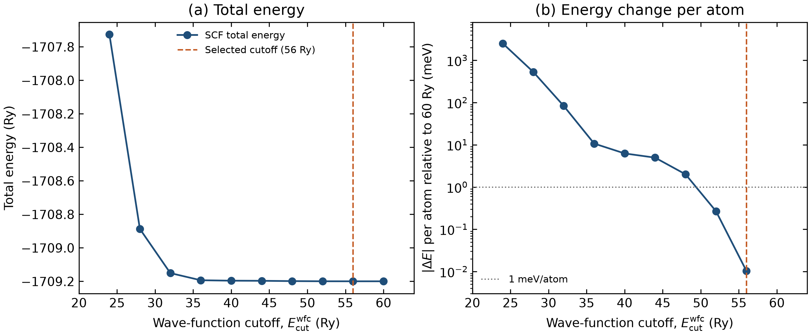

# Week 4 Project: Electronic structure of germanium

**MATE 250**  
**Stephen Reagin**

The goal of this project is to compute the band gap of diamond-structure germanium with density-functional theory and to document the calculation well enough that the result can be compared with experiment and with other computations. All production results below are from Quantum ESPRESSO 7.4.1. The completed workflow is a PBE calculation: cutoff and k-point tests, a variable-cell relaxation, and a final self-consistent field (SCF) calculation on the relaxed cell. That final SCF is the source of the band gap reported here.

## 1. Calculation settings

| Setting | Value |
| --- | --- |
| Exchange-correlation functional | PBE (Perdew-Burke-Ernzerhof GGA) |
| Code | Quantum ESPRESSO 7.4.1, `pw.x` |
| Pseudopotential | `ge_pbe_v1.4.uspp.F.UPF` (SSSP 1.3.0, PBE efficiency) |
| Pseudopotential type | Ultrasoft, scalar-relativistic, nonlinear core correction; 14 valence electrons (3d, 4s, 4p) |
| Wave-function cutoff | `ecutwfc = 56` Ry |
| Charge-density cutoff | `ecutrho = 448` Ry ($8 \times$ `ecutwfc`, required for an ultrasoft pseudopotential) |
| k-point mesh | Monkhorst-Pack $8 \times 8 \times 8$, unshifted |
| Electronic convergence | `conv_thr = 1.0d-8` Ry |
| Ionic energy criterion | `etot_conv_thr = 1.0d-4` Ry |
| Force criterion | `forc_conv_thr = 1.0d-4` Ry/Bohr |
| Cell-pressure criterion | 0.5 kbar (the threshold reported by the BFGS relaxation) |
| Relaxation | `calculation = 'vc-relax'`, `cell_dofree = 'xyz'` |

The structure is the conventional cubic cell of diamond Ge (8 atoms). The starting geometry was taken from the Materials Project, with cubic lattice parameter 5.674854 &Aring;. Because the pseudopotential is ultrasoft, the charge-density cutoff is eight times the wave-function cutoff. An ONCV pseudopotential would have used a factor of four.

The relaxation reached the requested thresholds in 4 BFGS steps (5 SCF cycles). The final enthalpy of the relaxed cell is -1709.208859 Ry.

## 2. Energy-cutoff convergence

Cutoff tests were static SCF calculations on the starting 8-atom cell, with `ecutrho` $= 8 \times$ `ecutwfc` and a $4 \times 4 \times 4$ mesh. The total energy is plotted in Figure 1. Panel (b) shows the same data as the energy per atom relative to the 60 Ry result.

**Figure 1.** Convergence of the PBE total energy with wave-function cutoff. The dashed line marks the cutoff used for relaxation and for the band-gap SCF.

| `ecutwfc` (Ry) | Total energy (Ry) | Energy above the 60 Ry result (meV/atom) |
| ---: | ---: | ---: |
| 24 | -1707.72654357 | 2505.20 |
| 28 | -1708.88691527 | 531.74 |
| 32 | -1709.15054545 | 83.38 |
| 36 | -1709.19327673 | 10.71 |
| 40 | -1709.19589391 | 6.25 |
| 44 | -1709.19664908 | 4.97 |
| 48 | -1709.19839129 | 2.01 |
| 52 | -1709.19941308 | 0.27 |
| **56** | **-1709.19956510** | **0.010** |
| 60 | -1709.19957118 | 0 |

I treated the cutoff as converged once raising it changed the total energy by less than 1 meV/atom. That threshold is crossed between 48 and 52 Ry: the 52 Ry energy is already only 0.27 meV/atom above the 60 Ry energy. At the selected cutoff of 56 Ry the residual is 0.010 meV/atom, and the last 4 Ry step (52 to 56 Ry) changes the energy by 0.26 meV/atom. The total-energy curve in Figure 1(a) is flat on the scale of the plot by about 40 Ry; 56 Ry sits well onto that plateau, so the production calculations are not limited by the basis-set cutoff.

The same 56 Ry cutoff was then used to test the k-mesh on the starting cell. Relative to a $14 \times 14 \times 14$ mesh, the energy error per atom is 6.96 meV at $4 \times 4 \times 4$, 0.85 meV at $6 \times 6 \times 6$, and 0.17 meV at $8 \times 8 \times 8$. The $8 \times 8 \times 8$ mesh used for relaxation and for the final SCF is therefore converged on the same 1 meV/atom scale.

## 3. Optimized lattice parameters

The relaxed cell remains cubic.

| Quantity | This work (PBE) |
| --- | ---: |
| $a$ | 5.758803 &Aring; |
| $b$ | 5.758803 &Aring; |
| $c$ | 5.758803 &Aring; |
| $\alpha$, $\beta$, $\gamma$ | 90&deg;, 90&deg;, 90&deg; |
| Cell volume | 190.984 &Aring;3 |
| Density | 5.052 g/cm3 |

The internal coordinates stay at the diamond positions. The largest deviation of a fractional coordinate from the ideal diamond value is about $3 \times 10^{-6}$.

### Literature comparison

**Computational reference.** R&ouml;dl, Furthm&uuml;ller, Suckert, Armuzza, Bechstedt, and Botti, *Phys. Rev. Materials* **3**, 034602 (2019), report a PBE lattice constant of 5.760 &Aring; for cubic Ge. Their settings were VASP with the projector-augmented-wave method, the PBE functional, a plane-wave cutoff of 500 eV, a $12 \times 12 \times 12$ $\Gamma$-centered mesh on the two-atom primitive cell, and the Ge 3d electrons treated as valence. Forces and total energies in that work were converged to 1 meV/atom.

**Experimental reference.** Baker and Hart, *Acta Crystallogr. Sect. A* **31**, 364 (1975), measured the lattice parameter of bulk single-crystal germanium by multiple-beam X-ray diffractometry. They compared the Ge 800 spacing with the Si 355 spacing in symmetric transmission geometry using Mo K$\alpha_1$ radiation, so the result does not depend on an absolute X-ray wavelength. At 25 &deg;C they obtained

$$a = 5.6579060 \pm 0.0000092\ \text{\AA}.$$

| Source | $a$ (&Aring;) | Difference from this work |
| --- | ---: | ---: |
| This work, PBE, relaxed | 5.758803 | -- |
| R&ouml;dl et al., PBE, VASP PAW | 5.760 | -0.0012 &Aring; (-0.021%) |
| Baker and Hart, bulk crystal, XRD, 25 &deg;C | 5.657906 | +0.1009 &Aring; (+1.78%) |

The two PBE calculations agree. A difference of 0.001 &Aring; is expected from the change of code, pseudopotential (ultrasoft in Quantum ESPRESSO versus PAW in VASP), plane-wave cutoff (56 Ry, about 762 eV, versus 500 eV), and k-point density. The pseudopotential is not the origin of the disagreement with experiment.

The experimental lattice parameter is smaller by 0.101 &Aring;. Three contributions are distinguishable, and only one of them is large.

1. **The PBE functional overestimates equilibrium volumes of solids.** R&ouml;dl et al. find the same shift with an independent PAW implementation: their PBE value is 5.760 &Aring;, while their PBEsol value, 5.673 &Aring;, is much closer to the room-temperature measurement. The error is in the exchange-correlation approximation. PBE underbinds Ge, so the energy minimum sits at too large a volume.
2. **Temperature.** The calculation is a static lattice. Baker and Hart measured a bulk crystal at 25 &deg;C. Thermal expansion between about 10 K and room temperature changes $a$ by only about 0.006 &Aring; (R&ouml;dl et al. compile 5.652 &Aring; at 10 K against 5.658 &Aring; at 298 K). That is about 6% of the 0.101 &Aring; discrepancy, so temperature does not explain the result.
3. **Sample and method.** The experimental number is for a bulk single crystal, not a thin film or a nanocrystal, and the diffractometry is an absolute lattice-parameter measurement. There is no strain or finite-size correction that should be applied before comparing it with a bulk calculation.

The relaxed density, 5.052 g/cm3, is lower than the room-temperature bulk density of germanium (5.323 g/cm3) by the same factor as the cube of the lattice-parameter ratio, which is the volume error written another way. The starting Materials Project lattice parameter, 5.674854 &Aring;, was already close to the PBEsol value. The variable-cell relaxation moved the cell from that geometry to the PBE minimum, which is what the comparison with R&ouml;dl et al. confirms.

## 4. Band gap

The band gap was taken from the final PBE SCF on the relaxed cell (`ecutwfc = 56` Ry, `ecutrho = 448` Ry, $8 \times 8 \times 8$ mesh). Quantum ESPRESSO reports

- highest occupied level = 7.7844 eV
- lowest unoccupied level = 7.7844 eV

The Kohn-Sham gap is therefore

$$E_g = 0.00\ \text{eV}.$$

Germanium is an indirect semiconductor. The valence-band maximum is at $\Gamma$ and the conduction-band minimum is at $L$ in the primitive-cell Brillouin zone. This calculation uses the 8-atom conventional cube. In that cell the primitive-cell $L$ point folds back to $\Gamma$, so the fundamental gap is present in the SCF eigenvalue difference. A difference of zero means the gap has closed. It is the result PBE gives for Ge, not a k-point that missed $L$.

### Comparison with reference values

| Reference | Gap (eV) | This work minus reference (eV) |
| --- | ---: | ---: |
| This work, PBE SCF | 0.00 | -- |
| Experiment, indirect gap at 300 K | 0.66 | -0.66 |
| Experiment, indirect gap at low temperature | 0.74 | -0.74 |
| R&ouml;dl et al., HSE06 indirect gap ($\Gamma \to L$) | 0.675 | -0.68 |
| R&ouml;dl et al., PBEsol Kohn-Sham gap at $L$ | 0.005 | -0.005 |

The room-temperature value is the optical gap quoted in the project description. The low-temperature indirect gap is 0.744 eV; Varshni's fit to the temperature dependence gives $E_g(0\ \text{K}) = 0.7412$ eV for the indirect edge (*Physica* **34**, 149, 1967). R&ouml;dl et al. list 0.664 eV from optical absorption at 291 K and 0.744 eV at low temperature. Their HSE06 number, 0.675 eV, was computed at the PBEsol lattice constant with spin-orbit coupling included.

### Why the calculated gap disagrees with experiment

The error against the low-temperature gap is -0.74 eV, and the error against the 300 K gap is -0.66 eV. The calculation is static, so the low-temperature optical gap is the closer experimental comparison. Warming from 0 K to 300 K lowers the gap by only about 0.08 eV through electron-phonon coupling. That shift is real, and it means a 0 K calculation should not be compared only with the 300 K number, but it is an order of magnitude smaller than the error found here.

The dominant cause is the functional. A PBE eigenvalue difference is not a quasiparticle gap: the functional lacks the derivative discontinuity that opens the gap of a semiconductor. For silicon the same error leaves a gap that is simply too small. For germanium the experimental gap is only 0.74 eV, and the PBE error is large enough to close it. The calculation therefore describes a semimetal. R&ouml;dl et al. find the same failure with PBEsol (0.005 eV at $L$, and a negative gap at $\Gamma$) and state directly that LDA and GGA predict metallic cubic Ge. The present 0.00 eV result agrees with that computational literature. It does not agree with experiment, and the disagreement is the known PBE error for this material.

The lattice error works in the same direction. The PBE cell is 1.8% too large, which is a volume expansion of about 5%. The gap of Ge decreases under expansion, so the oversized cell makes an already closed gap even less likely to open. R&ouml;dl et al. estimate that a lattice error below 0.4% changes the direct gap by less than 0.1 eV. The volume contribution is therefore secondary to the functional.

Spin-orbit coupling, which was not included, splits the valence band by about 0.30 eV. Its effect on the fundamental gap is a few tens of meV. It does not account for a missing 0.7 eV.

### One change that would improve the calculation

The useful next calculation is an HSE06 SCF on this relaxed geometry, with a norm-conserving pseudopotential. HSE06 mixes 25% short-range exact exchange into PBE. R&ouml;dl et al. obtain an indirect gap of 0.675 eV with HSE06, within 0.07 eV of the low-temperature optical gap and within 0.02 eV of the 300 K gap. That is the correction this result needs.

Two attempts in the project folder do not replace that calculation, and their outputs should not be reported as alternative gaps.

- The SCAN input used a PAW pseudopotential. Quantum ESPRESSO stopped with "Meta-GGA not implemented with USPP/PAW," so there is no SCAN energy or gap.
- The HSE input did request `input_dft = 'hse'`, but the output never reaches `JOB DONE`. The eigenvalues printed in that file, and the total energy -1709.20885866 Ry, are the PBE result: exact exchange is initialized only after those eigenvalues are written. The run also warned that a nonlinear core correction is inconsistent with a hybrid functional and that `ecutfock` is ignored for ultrasoft and PAW pseudopotentials.

A completed HSE06 calculation needs a norm-conserving pseudopotential, so that the Fock operator and the core correction are consistent, and it needs to be run through to a converged hybrid SCF. Doing that on the primitive two-atom cell would also put $\Gamma$ and $L$ on the k-path explicitly. The PBE geometry found here is already a suitable structure for that single-point calculation.

## References

1. J. P. Perdew, K. Burke, and M. Ernzerhof, "Generalized Gradient Approximation Made Simple," *Phys. Rev. Lett.* **77**, 3865 (1996).
2. C. R&ouml;dl, J. Furthm&uuml;ller, J. R. Suckert, V. Armuzza, F. Bechstedt, and S. Botti, "Accurate electronic and optical properties of hexagonal germanium for optoelectronic applications," *Phys. Rev. Materials* **3**, 034602 (2019).
3. J. F. C. Baker and M. Hart, "An absolute measurement of the lattice parameter of germanium using multiple-beam X-ray diffractometry," *Acta Crystallogr. Sect. A* **31**, 364 (1975).
4. Y. P. Varshni, "Temperature dependence of the energy gap in semiconductors," *Physica* **34**, 149 (1967).
5. P. Giannozzi et al., "Advanced capabilities for materials modelling with Quantum ESPRESSO," *J. Phys.: Condens. Matter* **29**, 465901 (2017).
