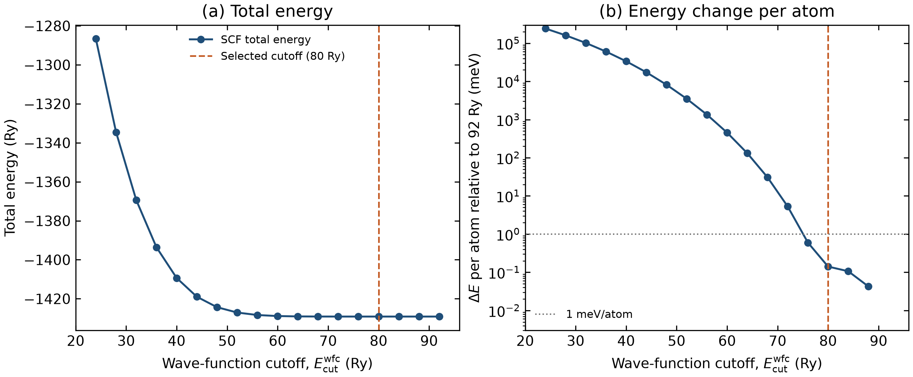

# Week 4 Project: Electronic structure of germanium with an ONCV pseudopotential

**MATE 250**  
**Stephen Reagin**

This report repeats the germanium band-gap project with a norm-conserving ONCV pseudopotential. The completed production calculation is a PBE variable-cell relaxation followed by a final SCF on the relaxed cell, both in Quantum ESPRESSO 7.4.1. A SCAN single-point job reached `JOB DONE` in Quantum ESPRESSO 7.5. That SCAN output is not a band gap of diamond germanium: the atomic coordinates in the input are Cartesian coordinates in &Aring; stored under the crystal tag, so the ions are not on the diamond sites. The HSE run did not finish. The gap reported below is the PBE result.

## 1. Calculation settings

| Setting | Value |
| --- | --- |
| Exchange-correlation functional | PBE |
| Code | Quantum ESPRESSO 7.4.1, `pw.x` |
| Pseudopotential | `Ge.upf`, generated with ONCVPSP 3.3.0 (Hamann) |
| Pseudopotential type | Norm-conserving, scalar-relativistic, nonlinear core correction; 14 valence electrons (3d, 4s, 4p) |
| Wave-function cutoff | `ecutwfc = 80` Ry |
| Charge-density cutoff | `ecutrho = 640` Ry ($8 \times$ `ecutwfc`) |
| k-point mesh | Monkhorst-Pack $14 \times 14 \times 14$, unshifted (120 irreducible k-points) |
| Electronic convergence | `conv_thr = 1.0d-8` Ry |
| Ionic energy criterion | `etot_conv_thr = 1.0d-4` Ry |
| Force criterion | `forc_conv_thr = 1.0d-4` Ry/Bohr |
| Cell-pressure criterion | 0.5 kbar |
| Relaxation | `calculation = 'vc-relax'`, `cell_dofree = 'xyz'` |

The cell is the conventional cube of diamond Ge, with 8 atoms. The starting lattice parameter, taken from the Materials Project, was 5.674854 &Aring;. The relaxation met the energy, force, and pressure thresholds in 4 BFGS steps. The final enthalpy is -1429.142586 Ry.

For a norm-conserving pseudopotential the charge density is determined by the square of the wave functions, and a density cutoff of $4 \times$ `ecutwfc` is the usual setting. These PBE runs used $8 \times$ `ecutwfc`. That is a finer density grid than the ONCV rule requires. Every cutoff test, the k-point tests, and the relaxation used the same factor, so the 80 Ry choice and the relaxed geometry belong to one consistent setup.

## 2. Energy-cutoff convergence

Cutoff tests were static SCF calculations on the starting cell, with an $8 \times 8 \times 8$ mesh (35 irreducible k-points) and `ecutrho` $= 8 \times$ `ecutwfc`. Figure 1 shows the total energy. This ONCV potential is harder than the ultrasoft Ge potential used in the earlier project: at 60 Ry the energy is still 455 meV/atom above the 92 Ry result, whereas the ultrasoft potential had already flattened near 56 Ry.

**Figure 1.** Convergence of the PBE total energy with wave-function cutoff for `Ge.upf`. The dashed line marks the cutoff used for relaxation and for the final SCF.

| `ecutwfc` (Ry) | Total energy (Ry) | Energy above the 92 Ry result (meV/atom) |
| ---: | ---: | ---: |
| 24 | -1286.67633147 | 242284 |
| 32 | -1369.37983387 | 101629 |
| 40 | -1409.34550293 | 33659 |
| 48 | -1424.33461983 | 8167 |
| 56 | -1428.34519899 | 1346 |
| 60 | -1428.86930385 | 455 |
| 64 | -1429.05957264 | 131 |
| 68 | -1429.11863429 | 30.8 |
| 72 | -1429.13361283 | 5.29 |
| 76 | -1429.13636913 | 0.60 |
| **80** | **-1429.13663912** | **0.14** |
| 84 | -1429.13665959 | 0.11 |
| 88 | -1429.13669724 | 0.042 |
| 92 | -1429.13672220 | 0 |

The full scan also contains 28, 36, 44, and 52 Ry. Those points lie on the same smooth curve in Figure 1 and are omitted from the table only to keep it readable.

I treated the cutoff as converged once a further increase changed the energy by less than 1 meV/atom. That happens between 72 and 76 Ry: the 76 Ry energy is 0.60 meV/atom above 92 Ry, and the step from 76 to 80 Ry is 0.46 meV/atom. At the selected cutoff of 80 Ry the residual against 92 Ry is 0.14 meV/atom. The total-energy curve is flat on the scale of Figure 1(a) once the cutoff passes about 72 Ry, and 80 Ry is on that plateau.

The k-mesh was then tested at 80 Ry on the same starting cell.

| Mesh | Total energy (Ry) | Energy above $14 \times 14 \times 14$ (meV/atom) |
| --- | ---: | ---: |
| $4 \times 4 \times 4$ | -1429.13263976 | 6.98 |
| $8 \times 8 \times 8$ | -1429.13663912 | 0.17 |
| $10 \times 10 \times 10$ | -1429.13671387 | 0.048 |
| $12 \times 12 \times 12$ | -1429.13673444 | 0.013 |
| $14 \times 14 \times 14$ | -1429.13674182 | 0 |

An $8 \times 8 \times 8$ mesh is already inside 1 meV/atom. The relaxation and the final SCF used $14 \times 14 \times 14$, which is the tightest mesh in the test. The k-point error in the production calculation is smaller than the residual cutoff error.

## 3. Optimized lattice parameters

The relaxed cell remains cubic.

| Quantity | This work (PBE, ONCV) |
| --- | ---: |
| $a$ | 5.762454 &Aring; |
| $b$ | 5.762454 &Aring; |
| $c$ | 5.762454 &Aring; |
| $\alpha$, $\beta$, $\gamma$ | 90&deg;, 90&deg;, 90&deg; |
| Cell volume | 191.347 &Aring;3 |
| Density | 5.042 g/cm3 |

The ions stay on the diamond sites. The largest shift of a fractional coordinate away from the ideal diamond value is about $9 \times 10^{-7}$.

### Literature comparison

**Computational reference.** R&ouml;dl, Furthm&uuml;ller, Suckert, Armuzza, Bechstedt, and Botti, *Phys. Rev. Materials* **3**, 034602 (2019), report a PBE lattice constant of 5.760 &Aring; for cubic Ge. Their settings were VASP, the projector-augmented-wave method, PBE, a plane-wave cutoff of 500 eV, a $12 \times 12 \times 12$ $\Gamma$-centered mesh on the two-atom primitive cell, and the Ge 3d electrons in the valence.

**Experimental reference.** Baker and Hart, *Acta Crystallogr. Sect. A* **31**, 364 (1975), measured bulk single-crystal germanium by multiple-beam X-ray diffractometry. They compared the Ge 800 spacing with the Si 355 spacing in symmetric transmission using Mo K$\alpha_1$ radiation, which removes the need for an absolute wavelength. At 25 &deg;C,

$$a = 5.6579060 \pm 0.0000092\ \text{\AA}.$$

| Source | $a$ (&Aring;) | Difference from this work |
| --- | ---: | ---: |
| This work, PBE, ONCV, relaxed | 5.762454 | -- |
| R&ouml;dl et al., PBE, VASP PAW | 5.760 | +0.0025 &Aring; (+0.043%) |
| Baker and Hart, bulk crystal, XRD, 25 &deg;C | 5.657906 | +0.1045 &Aring; (+1.85%) |

The two PBE calculations agree. The 0.0025 &Aring; difference is the expected scatter from changing the code, the pseudopotential, the cutoff, and the k-mesh. The same conclusion comes from the ultrasoft PBE relaxation in the earlier germanium calculation, which gave 5.7588 &Aring;, 0.0037 &Aring; below this ONCV result. The pseudopotential is not what sets the error against experiment.

The measured lattice parameter is smaller by 0.105 &Aring;. PBE underbinds solids, so the energy minimum sits at too large a volume. R&ouml;dl et al. see the same shift, and their PBEsol lattice constant, 5.673 &Aring;, falls much closer to the room-temperature measurement. Temperature is a small part of the discrepancy. The calculation is a static lattice, while Baker and Hart measured a bulk crystal at 25 &deg;C. Thermal expansion from about 10 K to room temperature changes $a$ by only about 0.006 &Aring;. The sample is a bulk single crystal, characterized by an absolute X-ray lattice-parameter measurement, so film strain or a nanocrystal size correction does not enter the comparison.

## 4. Band gap

### PBE

The gap is taken from the final SCF of the relaxation, on the relaxed cell, with `ecutwfc = 80` Ry, `ecutrho = 640` Ry, and a $14 \times 14 \times 14$ mesh. With 64 bands, Quantum ESPRESSO prints both edges:

- highest occupied level = 8.7892 eV
- lowest unoccupied level = 8.7892 eV

$$E_g(\text{PBE}) = 0.00\ \text{eV}.$$

The fundamental gap of Ge is indirect, from $\Gamma$ to $L$ in the primitive-cell Brillouin zone. In the 8-atom conventional cell the $L$ point folds to $\Gamma$, so that gap is contained in the SCF eigenvalue difference. Equal edges mean the gap has closed.

| Reference | Gap (eV) | This PBE result minus reference (eV) |
| --- | ---: | ---: |
| This work, PBE SCF | 0.00 | -- |
| Experiment, indirect gap at 300 K | 0.66 | -0.66 |
| Experiment, indirect gap at low temperature | 0.74 | -0.74 |
| R&ouml;dl et al., HSE06 indirect gap | 0.675 | -0.68 |
| Yao and Kanai, SCAN indirect gap | 0.57 | -0.57 |
| Yao and Kanai, PBE | 0 | 0.00 |

The 300 K value is the optical gap given in the project description. The low-temperature indirect gap is 0.744 eV, and Varshni's fit gives $E_g(0\ \text{K}) = 0.7412$ eV (*Physica* **34**, 149, 1967). R&ouml;dl et al. list 0.664 eV from optical absorption at 291 K. Yao and Kanai, *J. Chem. Phys.* **146**, 224105 (2017), also obtain a PBE gap of 0 eV for diamond Ge, and a SCAN gap of 0.57 eV when the pseudopotential is consistent with SCAN. Using a PBE pseudopotential inside their SCAN calculation lowered that gap to 0.19 eV.

The error against the low-temperature optical gap is -0.74 eV. Warming to 300 K lowers the measured gap by about 0.08 eV, so comparing a static calculation with the room-temperature number changes the discrepancy by that amount and leaves it intact. The cause is the functional. A PBE eigenvalue difference misses the derivative discontinuity. For germanium the experimental gap is small enough that this error closes it, and the calculation describes a semimetal. Yao and Kanai and R&ouml;dl et al. both report the same PBE failure. The 1.85% lattice expansion pushes in the same direction, because the gap of Ge decreases as the volume increases, but a sub-percent lattice error changes the gap by well under 0.1 eV. Spin-orbit coupling, which was not included, splits the valence band by about 0.30 eV and shifts the fundamental gap by only a few tens of meV.

### SCAN

The SCAN input requested `input_dft = 'scan'` on the relaxed lattice parameter $a = 5.762454$ &Aring;, with the SG15 pseudopotential `Ge_ONCV_PBE-1.2.upf`, `ecutwfc = 80` Ry, and an $8 \times 8 \times 8$ mesh. Quantum ESPRESSO defaulted the density cutoff to 320 Ry, which is $4 \times$ `ecutwfc` and is the appropriate ONCV factor. The job converged in 36 iterations and ended with `JOB DONE`. The printed edges are 7.6353 eV and 7.5386 eV, a difference of -0.097 eV.

That difference is not the SCAN gap of germanium. The coordinate block is tagged `{crystal}`, but the numbers are the relaxed fractional coordinates multiplied by $a$. For the first atom the relaxed crystal coordinate is 0.5000000000, and

$$0.5000000000 \times 5.762454494\ \text{\AA} = 2.881227247\ \text{\AA},$$

which is the number written in the SCAN input. Quantum ESPRESSO read 2.881227247 as a fraction of the cell. Reducing it by two lattice translations leaves 0.881, not the diamond coordinate 0.500. The same shift is present on the other seven sites.

Three lines in the SCAN output confirm that the ions are not on the diamond structure:

- The run finds 6 symmetry operations. The PBE diamond cell finds 24.
- The Ewald energy is +539.83 Ry. In the PBE relaxation of the same 8-atom formula unit the Ewald energy is -775.66 Ry. The Ewald term depends on the ionic positions and the valence charges, not on the exchange-correlation functional, so the two structures are different.
- The atomic mass in the SCAN input is 28.086, the mass of silicon, rather than 72.63. A static SCF eigenvalue does not depend on that mass. It is a second input error, and it would make a reported density meaningless.

A SCAN gap for diamond Ge has to be recomputed with the fractional coordinates already printed at the end of `ge.relax.out`.

### One change that would improve the calculation

Repeat the SCAN SCF with `ATOMIC_POSITIONS {crystal}` set to those fractional coordinates, and with the germanium mass set back to 72.63. The relaxed PBE cell and the 80 Ry cutoff can stay as they are. Yao and Kanai show what that class of calculation does: SCAN opens a gap that PBE closes, giving 0.19 eV with a PBE pseudopotential and 0.57 eV with a pseudopotential generated for SCAN, against the low-temperature optical gap of 0.74 eV. The SG15 file used here was generated for PBE, so the expected result is the smaller of those two corrections, still a qualitative change from the metallic PBE result.

The HSE input in this directory did start (`Exchange-correlation = HSE`) and never reached `JOB DONE`. A finished HSE06 SCF on the same relaxed diamond cell is the alternative if the target is the gap of about 0.68 eV reported by R&ouml;dl et al. The coordinate repair above is the change that makes the SCAN job already in hand into a result for germanium.

## References

1. J. P. Perdew, K. Burke, and M. Ernzerhof, "Generalized Gradient Approximation Made Simple," *Phys. Rev. Lett.* **77**, 3865 (1996).
2. J. Sun, A. Ruzsinszky, and J. P. Perdew, "Strongly Constrained and Appropriately Normed Semilocal Density Functional," *Phys. Rev. Lett.* **115**, 036402 (2015).
3. Y. Yao and Y. Kanai, "Plane-wave pseudopotential implementation and performance of SCAN meta-GGA exchange-correlation functional for extended systems," *J. Chem. Phys.* **146**, 224105 (2017).
4. C. R&ouml;dl, J. Furthm&uuml;ller, J. R. Suckert, V. Armuzza, F. Bechstedt, and S. Botti, "Accurate electronic and optical properties of hexagonal germanium for optoelectronic applications," *Phys. Rev. Materials* **3**, 034602 (2019).
5. J. F. C. Baker and M. Hart, "An absolute measurement of the lattice parameter of germanium using multiple-beam X-ray diffractometry," *Acta Crystallogr. Sect. A* **31**, 364 (1975).
6. Y. P. Varshni, "Temperature dependence of the energy gap in semiconductors," *Physica* **34**, 149 (1967).
7. D. R. Hamann, "Optimized norm-conserving Vanderbilt pseudopotentials," *Phys. Rev. B* **88**, 085117 (2013).
8. M. Schlipf and F. Gygi, "Optimization algorithm for the generation of ONCV pseudopotential libraries for density functional theory," *Comput. Phys. Commun.* **196**, 36 (2015).
