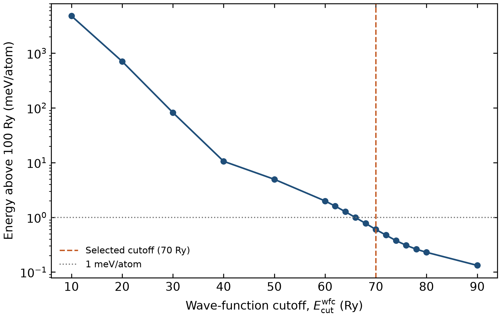
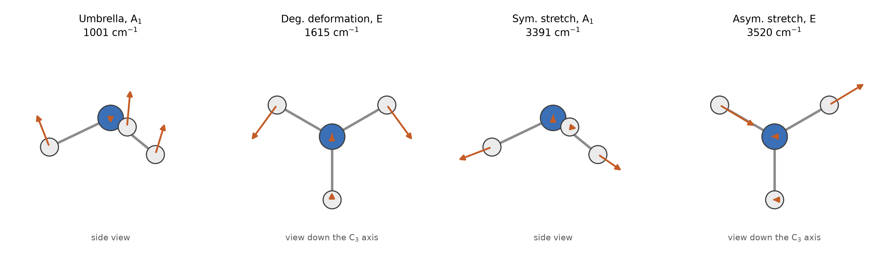
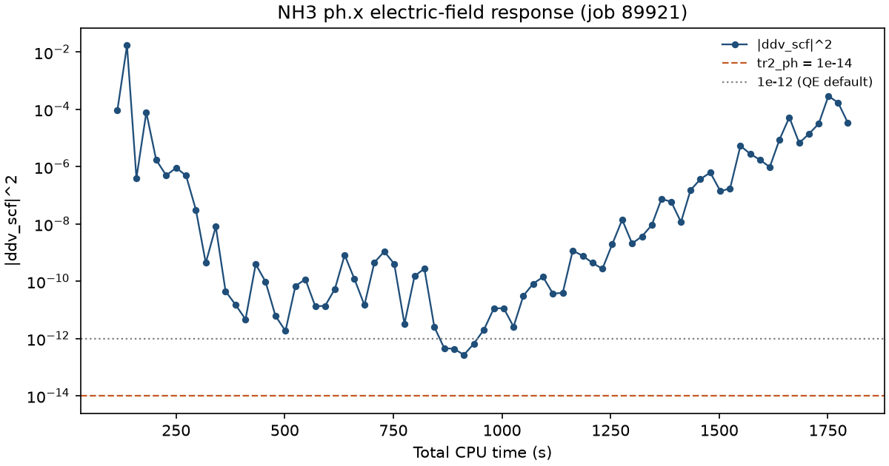

# Week 7 Project: Vibrational modes and IR spectrum of an isolated NH$_3$ molecule

**MATE 250**  
**Stephen Reagin**

*First draft. Bracketed items marked **[TO DO]** still need images or checks.*

## Summary

The vibrational modes and infrared spectrum of ammonia were calculated with density-functional theory. Quantum ESPRESSO relaxed the molecule, Phonopy obtained the vibrational modes by finite displacements, and density-functional perturbation theory (`ph.x`) gave the dielectric tensor and Born effective charges that set the IR intensities.

| Quantity | This work (PBE) | Experiment |
| --- | ---: | ---: |
| N-H bond length | 1.0207 &Aring; | 1.012 &Aring; |
| H-N-H angle | 106.54&deg; | 106.67&deg; |
| Umbrella mode, $\nu_2$ | 1001 cm$^{-1}$ | 950 cm$^{-1}$ |
| Degenerate deformation, $\nu_4$ | 1615 cm$^{-1}$ | 1627 cm$^{-1}$ |
| Symmetric stretch, $\nu_1$ | 3391 cm$^{-1}$ | 3337 cm$^{-1}$ |
| Asymmetric stretch, $\nu_3$ | 3521 cm$^{-1}$ | 3444 cm$^{-1}$ |
| Strongest IR band | umbrella, 124 km/mol | umbrella, 138 km/mol |

All four fundamentals are IR active, as the C$_{3v}$ symmetry of NH$_3$ requires. Three of the four frequencies agree with experiment to within 2.2%, and the calculated band intensities reproduce the measured ordering and magnitudes to within 16%. The umbrella mode has the largest error, +5.3%, which is consistent with its strongly anharmonic double-well potential.

## 1. Introduction

### Why atomic vibrations matter

Atoms in a molecule or solid are never stationary. Even at 0 K they vibrate about their equilibrium positions, and these vibrations control a large set of material properties. In a crystal the quantized vibrations are called phonons. In an isolated molecule the same motions are the molecule's normal modes.

Vibrations contribute to the entropy, and therefore to the free energy $G = H - TS$. Because the stable phase at a given temperature is the one with the lowest $G$, vibrational entropy can decide which crystal structure is stable and shift phase-transition temperatures. Vibrations also set the heat capacity (the Einstein and Debye models), the thermal expansion through the anharmonicity of the interatomic potential, and, in solids, the thermal conductivity. Melting is often described by the vibrational amplitude, through the Lindemann criterion. Vibrations scatter electrons, which contributes to electrical resistivity and, through electron-phonon coupling, to conventional superconductivity. They also contribute to the dielectric response.

### Principle of IR spectroscopy

A molecule absorbs infrared light when the photon frequency matches one of its vibrational frequencies *and* the vibration changes the molecular dipole moment $\boldsymbol\mu$. The oscillating dipole couples to the oscillating electric field of the light. A vibration that leaves the dipole unchanged cannot absorb, however strongly the atoms move.

The absorption frequency is set by the stiffness of the bonds and the masses of the moving atoms. For a single bond, $\omega = \sqrt{k/\mu_r}$, where $k$ is the force constant and $\mu_r$ the reduced mass. That is why N-H stretches appear near 3400 cm$^{-1}$: the bond is stiff and hydrogen is very light. The absorption strength is set by how strongly the dipole changes along the mode coordinate $Q$:

$$I \propto \left|\frac{\partial \boldsymbol\mu}{\partial Q}\right|^2.$$

Whether $\partial\boldsymbol\mu/\partial Q$ can be nonzero is decided by symmetry. A molecule has an inversion center if sending every atom at $\mathbf r$ to $-\mathbf r$, through that center, leaves it unchanged. The dipole moment reverses sign under inversion. A vibration that is symmetric under inversion therefore cannot change the dipole and is IR inactive. This is the rule of mutual exclusion, and it applies only to centrosymmetric molecules. CO$_2$ is the standard example: its symmetric stretch is IR inactive, and only the bend (667 cm$^{-1}$) and asymmetric stretch (2349 cm$^{-1}$) absorb. NH$_3$ is a trigonal pyramid with no inversion center, so this restriction does not apply to it (Section 3.4).

Because each type of bond absorbs at characteristic frequencies, IR spectroscopy identifies chemical groups. Fourier-transform IR (FTIR) is routine in polymer science for exactly this reason. For example, the cure of a UV-curable acrylate can be followed by measuring the spectrum of the liquid resin and of the cured film: the acrylate C=C absorption shrinks as the double bonds are consumed, so the change gives the degree of conversion.

## 2. Methods

### 2.1 Calculation settings

| Setting | Value |
| --- | --- |
| Codes | Quantum ESPRESSO 7.4.1 (`pw.x`, `ph.x`); Phonopy 2.21.2; IR-JaGeo |
| Exchange-correlation functional | PBE |
| Pseudopotentials (SSSP 1.3.0 efficiency) | H: `H.pbe-rrkjus_psl.1.0.0.UPF`, ultrasoft; N: `N.pbe-n-radius_5.UPF`, ultrasoft with nonlinear core correction |
| `ecutwfc` / `ecutrho` | 70 Ry / 280 Ry ($4\times$, default) |
| Simulation box | Cubic, $a$ = 15 &Aring; (`ibrav = 0`) |
| k-points | $1 \times 1 \times 1$ ($\Gamma$ only, isolated molecule) |
| Relaxation | `calculation = 'relax'`, `forc_conv_thr = 1.0d-5` Ry/Bohr, `conv_thr = 1.0d-8` Ry |
| Phonopy | `--dim="1 1 1"`, displacement amplitude 0.02 Bohr (0.0106 &Aring;), 14 displaced structures |
| SCF before `ph.x` | `conv_thr = 1.0d-12` Ry |
| `ph.x` | `epsil = .true.`, `trans = .false.`, `asr = .true.`, `tr2_ph = 1.0d-14` |
| Frequency conversion | 3635.80974105 cm$^{-1}$ per $\sqrt{\text{Ry}/(\text{Bohr}^2\,\text{amu})}$ |

### 2.2 Simulation box and initial structure

The molecule was placed in a 15 &Aring; cubic box, with N at the box center and the C$_3$ axis along $z$. The molecule is about 1.6 &Aring; across, so periodic images are separated by more than 13 &Aring; of vacuum. The initial geometry is the experimental structure tabulated by NIST (Herzberg: $r_{\mathrm{NH}}$ = 1.012 &Aring;, $\angle$HNH = 106.67&deg;). Its Cartesian coordinates were shifted by half the box length and divided by 15 &Aring; to give fractional coordinates:

| Atom | $x$ | $y$ | $z$ |
| --- | ---: | ---: | ---: |
| N | 0.50000 | 0.500000 | 0.50000 |
| H | 0.50000 | 0.437487 | 0.47456 |
| H | 0.55414 | 0.531260 | 0.47456 |
| H | 0.44586 | 0.531260 | 0.47456 |

### 2.3 Cutoff convergence

Static SCF calculations on the initial structure were run from 10 to 100 Ry, with 2 Ry steps between 60 and 80 Ry (Figure 1). With the finer steps, every increment above 60 Ry changes the energy by less than 1 meV/atom, so I measured convergence against the 100 Ry result instead of between successive cutoffs. The energy falls below 1 meV/atom of the reference at 66 Ry, but only barely (0.99 meV/atom), and the reference itself is still decreasing slightly. I chose 70 Ry, where the residual is 0.60 meV/atom.

**Figure 1.** Total energy per atom above the 100 Ry result. The dashed line marks the selected cutoff and the dotted line is 1 meV/atom.

| `ecutwfc` (Ry) | 50 | 60 | 64 | 66 | 68 | **70** | 74 | 80 | 90 |
| --- | ---: | ---: | ---: | ---: | ---: | ---: | ---: | ---: | ---: |
| Above 100 Ry (meV/atom) | 4.95 | 1.99 | 1.26 | 0.99 | 0.77 | **0.60** | 0.38 | 0.23 | 0.13 |

### 2.4 Workflow

1. **Relaxation.** The molecule was relaxed at 70 Ry. BFGS converged in 7 steps, to a total residual force of $4.5 \times 10^{-5}$ Ry/Bohr.
2. **Vibrational modes.** Phonopy generated displaced copies of the relaxed cell, `pw.x` calculated the forces in each, and Phonopy assembled the force constants into `FORCE_SETS` and diagonalized the dynamical matrix at $\Gamma$. Phonopy recognized only the mirror plane $x = 1/2$ in the box (space group Pm), so atoms 1 (N), 2 (H, on the plane), and 3 (H) are symmetry-independent. Atom 4 is the mirror image of atom 3. These three atoms were displaced, in 4, 4, and 6 structures respectively.
3. **Dielectric tensor and Born effective charges.** A tightly converged SCF of the relaxed structure was followed by a `ph.x` linear-response calculation for a uniform electric field, at $\Gamma$ only (`trans = .false.`, since the modes were already known from step 2).
4. **IR spectrum.** The Born charges of atoms 1 to 3 were written to `BORN`, and the IR code combined `BORN`, `FORCE_SETS`, and the relaxed structure (`POSCAR`) to obtain the oscillator strength of each mode.

The first `ph.x` attempt used the default SCF threshold of $10^{-8}$ Ry and failed to converge (Appendix A). Tightening the SCF to $10^{-12}$ Ry fixed it.

## 3. Results and discussion

### 3.1 Optimized structure

| Atom | $x$ | $y$ | $z$ |
| --- | ---: | ---: | ---: |
| N | 0.5000000000 | 0.5000010969 | 0.5002562066 |
| H | 0.5000000000 | 0.4370317001 | 0.4744747896 |
| H | 0.5545343022 | 0.5314869350 | 0.4744745019 |
| H | 0.4454656978 | 0.5314869350 | 0.4744745019 |

| | This work (PBE) | Experiment (Herzberg) | Difference |
| --- | ---: | ---: | ---: |
| $r_{\mathrm{NH}}$ | 1.0207 &Aring; | 1.012 &Aring; | +0.0087 &Aring; (+0.86%) |
| $\angle$HNH | 106.54&deg; | 106.67&deg; | -0.13&deg; |

The three N-H bonds and the three H-N-H angles stay equal to within $10^{-4}$ &Aring; and $10^{-3}$&deg;, so the relaxation preserved the C$_{3v}$ shape. PBE lengthens the N-H bond by 0.9%. GGA functionals typically slightly overestimate bond lengths, and a longer bond is a softer bond, which matters for the stretching frequencies in Section 3.5.

**[TO DO: VESTA snapshot of the relaxed molecule.]**

### 3.2 Vibrational modes

| Mode | Frequency (cm$^{-1}$) | Symmetry | Description |
| --- | ---: | --- | --- |
| 1 to 6 | -37.3, -36.0, -2.0, 10.1, 15.9, 48.7 | -- | Rigid translations and rotations |
| 7 | 1000.6 | A$_1$ | Umbrella (symmetric deformation), $\nu_2$ |
| 8, 9 | 1615.0, 1615.4 | E | Degenerate deformation (bend), $\nu_4$ |
| 10 | 3391.2 | A$_1$ | Symmetric N-H stretch, $\nu_1$ |
| 11, 12 | 3520.5, 3520.6 | E | Asymmetric N-H stretch, $\nu_3$ |

Each mode was assigned from its eigenvector by computing how it changes the three N-H bond lengths and the three H-N-H angles:

- **Umbrella (1001 cm$^{-1}$).** All three angles open together and the bond lengths barely change. The hydrogens move up and outward while the heavier nitrogen moves slightly down, so the pyramid flattens, like an umbrella turning inside out.
- **Degenerate deformation (1615 cm$^{-1}$).** The angles change but their changes sum to zero: one angle opens while the others close. This is a scissoring motion, with two independent components of the same frequency.
- **Symmetric stretch (3391 cm$^{-1}$).** All three bonds lengthen together, with almost no angle change.
- **Asymmetric stretch (3521 cm$^{-1}$).** The bond-length changes sum to zero: one bond lengthens while the others shorten. Again, there are two components of the same frequency.

**Figure 2.** Displacement patterns from the Phonopy eigenvectors (arrows are $\mathbf e/\sqrt{m}$, scaled to the largest displacement in each mode). N is blue and H is white. One component of each degenerate E pair is shown. In every mode, N moves much less than H because it is 14 times heavier and the center of mass stays fixed.

**[TO DO: Jmol images of the four modes, generated with `phonopy --anime`.]**

### 3.3 Number of modes and equation of motion

NH$_3$ has $N = 4$ atoms and therefore $3N = 12$ degrees of freedom. Three describe rigid translation and three describe rigid rotation of the nonlinear molecule, neither of which stretches a bond. That leaves $3N - 6 = 6$ vibrations. Because of the C$_{3v}$ symmetry they appear as four distinct frequencies: two non-degenerate A$_1$ modes and two doubly degenerate E pairs.

The calculation returns all 12 eigenvalues. Six are the vibrations above, and the other six lie between -37 and +49 cm$^{-1}$. These six should be exactly zero, since moving or rotating the whole molecule costs no energy. They are not exactly zero because of:

- the finite-displacement method, in which each force constant is a numerical difference with its own noise;
- the real-space integration grid, which slightly breaks translational invariance, so the energy changes a little when the whole molecule moves relative to the grid ("egg-box" effect); and
- the fact that rotational invariance is not enforced on the force constants at all.

Negative values are imaginary frequencies, from small negative eigenvalues. The degenerate pairs are split by 0.1 to 0.4 cm$^{-1}$, for a related reason: the cubic box has no three-fold axis along $z$, so the computed symmetry is only the single mirror plane.

The modes come from Newton's equations in the harmonic approximation. Expanding the energy to second order in the displacements $u_{k\alpha}$ (atom $k$, Cartesian direction $\alpha$) gives

$$m_k \ddot u_{k\alpha} = -\sum_{k'\beta} \Phi_{k\alpha,k'\beta}\, u_{k'\beta}, \qquad \Phi_{k\alpha,k'\beta} = \frac{\partial^2 E}{\partial u_{k\alpha}\,\partial u_{k'\beta}},$$

where $\Phi$ is obtained from the forces in the displaced structures. Substituting $u_{k\alpha} = e_{k\alpha}\, e^{-i\omega t}/\sqrt{m_k}$ gives the eigenvalue problem

$$\sum_{k'\beta} D_{k\alpha,k'\beta}\, e_{k'\beta} = \omega^2 e_{k\alpha}, \qquad D_{k\alpha,k'\beta} = \frac{\Phi_{k\alpha,k'\beta}}{\sqrt{m_k m_{k'}}}.$$

The $3N$ eigenvalues of the dynamical matrix $D$ are the squared frequencies, and its eigenvectors are the mode shapes in Figure 2. For an isolated molecule only the $\Gamma$ point ($\mathbf q = 0$) is needed.

### 3.4 IR spectrum and IR activity

The IR intensity of mode $m$ is proportional to the square of the dipole change along that mode. It is computed from the Born effective charges $Z^*_k$ and the eigenvector:

$$I_m \propto \sum_\alpha \left|\sum_{k\beta} Z^*_{k,\alpha\beta}\, \frac{e_{m,k\beta}}{\sqrt{m_k}}\right|^2.$$

The Born charges with the acoustic sum rule applied are $-0.383\,e$ for N (mean of the diagonal) and $+0.128\,e$ for each H. All nine Cartesian components sum to zero over the four atoms, as the sum rule requires. The electronic dielectric constant is $\varepsilon_{xx} = \varepsilon_{yy} = 1.0081$ and $\varepsilon_{zz} = 1.0096$. It is close to 1 because one small molecule occupies a 15 &Aring; box.

**Figure 3.** (a) Calculated IR spectrum. Each mode is broadened by a Gaussian of $\sigma$ = 20 cm$^{-1}$ for display, and the thin lines are the individual oscillator strengths. The six near-zero modes are omitted. (b) Calculated and experimental band intensities. The calculated intensities are the oscillator strengths converted to km/mol, summed over each degenerate pair.

**All four fundamentals are IR active**, and the spectrum shows four peaks, as expected. NH$_3$ belongs to point group C$_{3v}$. Its vibrations transform as $2A_1 + 2E$, and in C$_{3v}$ the dipole components transform as $A_1$ ($z$) and $E$ ($x, y$). Every vibration can therefore change the dipole: the A$_1$ modes along the C$_3$ axis and the E modes perpendicular to it. Six vibrations give four peaks because each degenerate pair absorbs at one frequency. NH$_3$ has no inversion center, so nothing forces any mode to be IR inactive, unlike the symmetric stretch of CO$_2$. (All four NH$_3$ fundamentals are also Raman active.)

The intensities vary by a factor of 26. The umbrella mode dominates: the hydrogens move almost parallel to the C$_3$ axis, which is the direction of the permanent dipole, so the dipole changes strongly. The two stretches are weak even though they move the hydrogens farthest. This illustrates that IR intensity depends on how much the dipole changes, not on how far the atoms move.

As a check on the dielectric calculation, the Clausius-Mossotti relation for a cubic array of molecules,

$$\frac{\varepsilon - 1}{\varepsilon + 2} = \frac{4\pi\alpha}{3V},$$

gives a mean polarizability $\alpha$ = 2.30 &Aring;$^3$ from $V$ = 3375 &Aring;$^3$. The experimental value is 2.103 &Aring;$^3$, so the calculation is 9.5% high. GGA functionals are known to overestimate molecular polarizabilities somewhat.

### 3.5 Comparison with literature

| Mode | Calculated (cm$^{-1}$) | Experiment (cm$^{-1}$) | Error | Calculated (km/mol) | Experiment (km/mol) |
| --- | ---: | ---: | ---: | ---: | ---: |
| $\nu_2$, umbrella (A$_1$) | 1000.6 | 950 | +5.3% | 124.0 | 138.0 &plusmn; 6.0 |
| $\nu_4$, deformation (E) | 1615.2 | 1627 | -0.7% | 27.2 | 28.2 &plusmn; 0.5 |
| $\nu_1$, sym. stretch (A$_1$) | 3391.2 | 3337 | +1.6% | 6.0 | 7.1 &plusmn; 0.8 |
| $\nu_3$, asym. stretch (E) | 3520.6 | 3444 | +2.2% | 4.7 | 4.3 &plusmn; 0.7 |

The experimental frequencies are the gas-phase fundamentals compiled by Shimanouchi, and the experimental intensities are the absolute band intensities measured by Koops, Visser, and Smit, both as listed in the NIST CCCBDB.

**Frequencies.** Three of the four modes agree to within 2.2%. The deviations have two main sources that partly cancel:

1. **The harmonic approximation.** A measured fundamental is the $0 \to 1$ transition in the true, anharmonic potential. Anharmonicity lowers it below the harmonic frequency, typically by a few percent for X-H stretches. A harmonic calculation therefore tends to land above the measured fundamental, which is the sign of the error for both stretches.
2. **The functional.** PBE makes the N-H bond 0.9% too long (Section 3.1). A longer bond is softer, which lowers the harmonic stretching frequencies. This partly offsets the harmonic overestimate, so the stretch errors are only 1.6 to 2.2%.

**The umbrella mode** has the largest error, +5.3%, and is a special case. Ammonia can invert through its planar geometry, so the umbrella coordinate has a double-well potential with a barrier of only about 2000 cm$^{-1}$. Tunneling between the wells splits the $\nu_2$ band into two components near 932 and 968 cm$^{-1}$, which average to the tabulated 950 cm$^{-1}$. **[TO DO: confirm the 932/968 cm$^{-1}$ values and the barrier height against a reference.]** A harmonic calculation expands the potential around the bottom of one well, where it is stiffer than the full double well that the vibration actually explores. It therefore overestimates this frequency more than the others.

**Intensities.** The calculated band intensities reproduce the experimental ordering, umbrella > deformation > symmetric stretch > asymmetric stretch, and match the measured values to between 4% (deformation) and 16% (symmetric stretch). That level of agreement is notable, since the Born charges are a separate calculation from the frequencies. It confirms that the `BORN` file was built for the correct atoms and that the dipole response is described well. The conversion to km/mol, $(4.8032\ \text{D}/e\,\text{\AA})^2 \times 42.256$ km/mol per (D/&Aring;)$^2$/amu, assumes the IR code reports $|\partial\boldsymbol\mu/\partial Q|^2$ in $e^2$/amu. The agreement with experiment supports that assumption.

**Other limitations.** The calculation describes one molecule at 0 K in a periodic box, while the measurements are of the gas at room temperature. Box size was not converged separately. The dielectric constant is only 0.8 to 1% above 1, so dipole-dipole interactions between images are small, but a larger box would confirm that. The finite-displacement amplitude (0.0106 &Aring;) is small enough for the harmonic approximation but contributes the numerical noise seen in the near-zero modes.

## 4. Conclusions

PBE with SSSP ultrasoft pseudopotentials, 70 Ry, and a 15 &Aring; box reproduces the structure and IR spectrum of NH$_3$ well. The bond length is 0.9% long, three of four vibrational frequencies are within 2.2% of experiment, and the IR band intensities are within 16%. The calculation gives $3N = 12$ eigenvalues, of which six are near-zero translations and rotations and six are the $2A_1 + 2E$ vibrations. All four distinct fundamentals are IR active because NH$_3$ has C$_{3v}$ symmetry and no inversion center. The largest error, in the umbrella mode, comes from the harmonic approximation applied to the double-well inversion potential. An anharmonic treatment of that coordinate would be the most direct improvement.

## Appendix A. `ph.x` convergence

The first `ph.x` run used an SCF converged to $10^{-8}$ Ry. The linear-response residual $|\Delta v_{\mathrm{scf}}|^2$ fell to $2.7 \times 10^{-13}$ after 36 iterations, never reached `tr2_ph` = $10^{-14}$, and then diverged until the job reached its 30-minute limit (Figure A1). The response calculation is built on the SCF wave functions and cannot converge more tightly than they did. After the SCF was tightened to $10^{-12}$ Ry, it converged in 5 iterations, reaching $1.8 \times 10^{-15}$, in 5 min 37 s of wall time.

**Figure A1.** $|\Delta v_{\mathrm{scf}}|^2$ versus CPU time for the first `ph.x` run (job 89921). Dashed line: `tr2_ph` = $10^{-14}$. Dotted line: $10^{-12}$.

## Appendix B. IR-code frequency conversion

The IR code reported every frequency 3.264% higher than Phonopy's `qpoints.yaml`, although both use the same `FORCE_SETS`. The ratio is the same for every mode, and for the Week 6 H$_2$O calculation. It equals the ratio of the conversion factor set in `IRDipoleApprox.py` (`VaspToCm*14.399652/2`, about 3754.5) to the Quantum ESPRESSO conversion factor (3635.80974105). The frequencies in this report are taken from `qpoints.yaml`. The oscillator strengths, which are built from the eigenvectors and Born charges and should not depend on this factor, are taken from the IR code. **[TO DO: rerun `data_treat.py` with `factor=3635.80974105` and confirm that the frequencies match `qpoints.yaml` and the oscillator strengths are unchanged.]**

## References

1. J. P. Perdew, K. Burke, and M. Ernzerhof, "Generalized Gradient Approximation Made Simple," *Phys. Rev. Lett.* **77**, 3865 (1996).
2. P. Giannozzi et al., "Advanced capabilities for materials modelling with Quantum ESPRESSO," *J. Phys.: Condens. Matter* **29**, 465901 (2017).
3. G. Prandini, A. Marrazzo, I. E. Castelli, N. Mounet, and N. Marzari, "Precision and efficiency in solid-state pseudopotential calculations," *npj Comput. Mater.* **4**, 72 (2018).
4. A. Togo and I. Tanaka, "First principles phonon calculations in materials science," *Scr. Mater.* **108**, 1 (2015).
5. S. Baroni, S. de Gironcoli, A. Dal Corso, and P. Giannozzi, "Phonons and related crystal properties from density-functional perturbation theory," *Rev. Mod. Phys.* **73**, 515 (2001).
6. IR-JaGeo, infrared intensities from Phonopy results, https://github.com/JaGeo/IR.
7. T. Shimanouchi, *Tables of Molecular Vibrational Frequencies, Consolidated Volume I*, NSRDS-NBS 39 (National Bureau of Standards, 1972), doi:10.6028/NBS.NSRDS.39.
8. Th. Koops, T. Visser, and W. M. A. Smit, "Measurement and interpretation of the absolute infrared intensities of NH$_3$ and ND$_3$," *J. Mol. Struct.* **96**, 203 (1983).
9. G. Herzberg, *Electronic Spectra and Electronic Structure of Polyatomic Molecules* (Van Nostrand, New York, 1966).
10. T. N. Olney, N. M. Cann, G. Cooper, and C. E. Brion, "Absolute scale determination for photoabsorption spectra and the calculation of molecular properties using dipole sum-rules," *Chem. Phys.* **223**, 59 (1997).
11. NIST Computational Chemistry Comparison and Benchmark Database, experimental data for NH$_3$, https://cccbdb.nist.gov/exp2x.asp?casno=7664417&charge=0.
